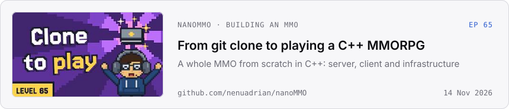
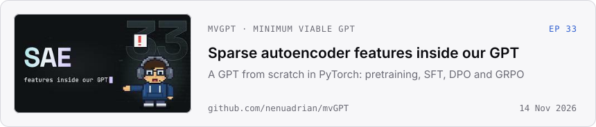
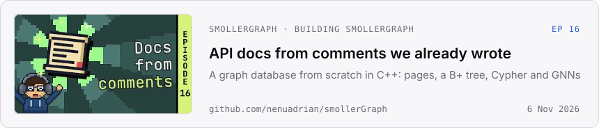
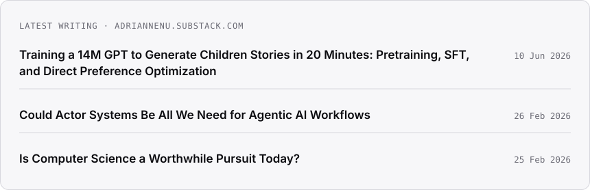

<a href="https://nenuadrian.com">
  <picture>
    <source media="(prefers-color-scheme: dark)" srcset="https://raw.githubusercontent.com/nenuadrian/nenuadrian/output/hero-dark.svg">
    
  </picture>
</a>

[Website](https://nenuadrian.com) · [Google Scholar](https://scholar.google.com/citations?user=nrKouOEAAAAJ) · [YouTube](https://www.youtube.com/@adrian-m-nenu) · [Substack](https://adriannenu.substack.com) · [LinkedIn](https://www.linkedin.com/in/nenuadrian/) · [contact@nenuadrian.com](mailto:contact@nenuadrian.com)

### Building in public

I build systems from scratch on camera, and every step of every episode is a git tag you can check out and run.

<a href="https://github.com/nenuadrian/nanoMMO">
  <picture>
    <source media="(prefers-color-scheme: dark)" srcset="https://raw.githubusercontent.com/nenuadrian/nenuadrian/output/nanommo-dark.svg">
    
  </picture>
</a>
<a href="https://github.com/nenuadrian/mvGPT">
  <picture>
    <source media="(prefers-color-scheme: dark)" srcset="https://raw.githubusercontent.com/nenuadrian/nenuadrian/output/mvgpt-dark.svg">
    
  </picture>
</a>
<a href="https://github.com/nenuadrian/smollerGraph">
  <picture>
    <source media="(prefers-color-scheme: dark)" srcset="https://raw.githubusercontent.com/nenuadrian/nenuadrian/output/smollergraph-dark.svg">
    
  </picture>
</a>

### Research

PhD in Computer Science and AI at the [University of Manchester](https://research.manchester.ac.uk/en/persons/adrian-mircea-nenu) (2025–). I work on reinforcement learning and reasoning: improving policy optimisation with policy gradients and expectation maximisation, and world models that support reasoning models.

- **2026** · Poster at TAROS 2026, *Towards Autonomous Robotic Systems*
- **2026** · Track editor, [ARC: AI Workflows for Applied Research and Evaluation](https://event.leconfe.com/aicuoi/scheduled/ARC-AWARE-Workshop-2026), international workshop
- **2025** · Inventor, US patent application [20250343728](https://patentscope.wipo.int/search/en/detail.jsf?docId=US466746514), *Agentically-orchestrated foundational models for cloud architecture development* (Google)
- **2024** · Reviewer, ICDCC 2024, International Conference on Data, Computation and Communication

### Writing

<a href="https://adriannenu.substack.com">
  <picture>
    <source media="(prefers-color-scheme: dark)" srcset="https://raw.githubusercontent.com/nenuadrian/nenuadrian/output/writing-dark.svg">
    
  </picture>
</a>

### Previously

- **Google Cloud**, New York · Software engineer on Monarch, a planet-scale in-memory time-series database · 2024–25
- **Google Cloud Go-to-Market**, New York and London · Built an LLM-agent recommendation platform · 2023–24
- **Google Professional Services**, London · Solutions engineer; built and open-sourced website performance tools · 2022
- **Morgan Stanley**, London · Senior software engineer on large-scale data systems and graph analysis; *Leading with Exceptional Ideas*, Global Technology Excellence Awards · 2015–22
- **Education** · BSc Computer Science, Manchester (2017) · MSc Business Analytics, Bath (2023)

### Service

- Member and application reviewer, [UK Young Academy](https://ukyoungacademy.org/members/adrian-mircea-nenu/) (2026–31)
- Trustee, Society of Research Software Engineering (2025–27)
- IEEE Senior Member; chair of the Young Professionals volunteering subcommittee
- Chartered IT Professional (CITP), BCS
- Senior technical expert, GDG on Campus Manchester · Co-founder, [ECHO AI](https://github.com/ECHO-ROMANIA) · Technical lead, Romanian Brain Bee

<b>More things I've built</b>

 

- [Hades Neural Engine](https://github.com/nenuadrian/hades-neural-engine): a reinforcement learning framework in C++ on LibTorch
- [JoltGym](https://github.com/nenuadrian/JoltGym): can the Jolt physics engine stand in for MuJoCo in multi-agent RL?
- [GradientHound](https://github.com/nenuadrian/GradientHound): BloodHound, from cybersecurity, brought to model architectures and policies
- [Hades](https://github.com/nenuadrian/hades-game-engine): an ML-enabled game engine in C++ and Vulkan
- [LaTeX++](https://github.com/nenuadrian/latex-plus-plus): math expressions to extruded meshes, from OpenType fonts
- [InteligentArtificiala.ro](https://inteligentartificiala.ro): learning material on AI, in Romanian
- [M.I.N.E.R.V.A.](https://aboutminerva.com): an invite-only research workspace for academics
- [Secret Republic](https://github.com/nenuadrian/secret-republic-browser-based-cyber-security-rpg-v4): an open-source, browser-based cyber-security RPG

The header and cards rebuild themselves from YouTube and Substack every six hours, by [a workflow in this repository](https://github.com/nenuadrian/nenuadrian/blob/main/.github/workflows/profile.yml).
